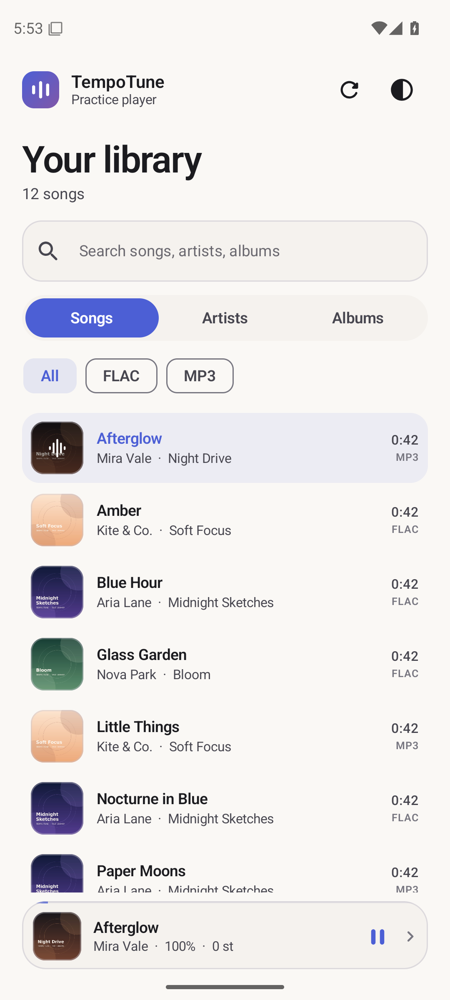
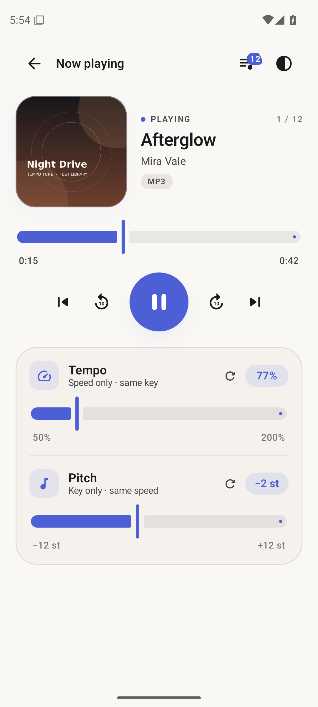
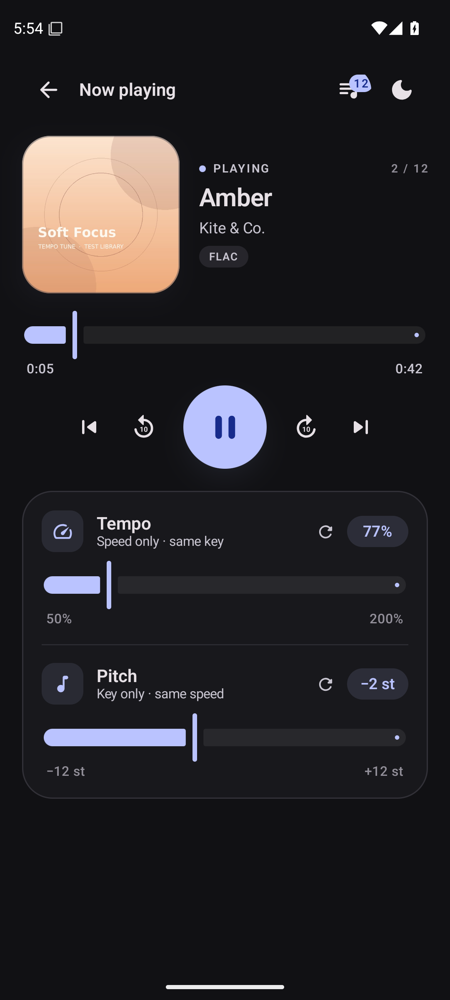

# TempoTune

A local-first Android music player built for music practice. Browse your on-device
library, then slow down or re-pitch any track independently while it plays.

<p>
  
  
  
</p>

## Features

- **Local library**: scans the device audio collection through MediaStore and shows
  songs, artists, and albums. FLAC, MP3, M4A, OGG, OPUS, WAV, AIFF and other
  device-supported formats appear in one library.
- **Search and filters**: live search across title, artist, and album; format
  filters; album/artist drill-down views; clear active filters in one tap.
- **Tempo**: 50%–200% slider. Changes playback speed without changing musical key.
- **Pitch**: −12 to +12 semitone slider. Changes musical key without changing speed.
- **Independent, live controls**: both sliders update ExoPlayer immediately, with a
  reset action for each. Settings persist between tracks and app launches.
- **Background playback**: a Media3 `MediaSessionService` keeps audio running with
  lock-screen/notification controls, audio focus, and noisy-headphone handling.
- **Music-player essentials**: queue, seek, previous/next, ±10 second jumps,
  album artwork, and autoplay of the next track.
- **Light, dark, or system theme** with a matching full Material 3 palette.
- **Local only**: no INTERNET permission, no analytics, no uploads. The library is
  read through Android's MediaStore and nothing is copied off the device.

## Requirements

- Android 8.0+ (API 26)
- The app asks for **Music and audio** access so it can read the local library.
- Notification permission is requested for playback controls. Playback itself
  still works if notifications are declined.

## Install

Download the signed APK from the
[latest GitHub release](https://github.com/MohammedAlamkhan/TempoTune/releases/latest).

```bash
adb install -r TempoTune-v1.0.0.apk
```

Or copy the APK to the phone and open it with a file manager. You may need to allow
"Install unknown apps" for that file manager once.

## Use

1. Open TempoTune and allow music access.
2. Browse **Songs**, **Artists**, or **Albums**, or search by title/artist/album.
   Use the format chips to narrow the song list.
3. Tap a song to play. The mini player at the bottom opens the practice screen.
4. Drag **Tempo** (50–200%) or **Pitch** (−12…+12 st). Both apply live. The
   circular-arrow buttons next to changed values reset them.
5. Tap the queue icon (top right) to see the current playback queue.

## Build

```bash
export JAVA_HOME=/path/to/jdk21
./gradlew :app:assembleRelease
```

The APK is written to `app/build/outputs/apk/release/app-release.apk`.

- Android SDK 35 and JDK 17+ are required.
- The Gradle wrapper downloads Gradle 8.13 on first use. An installed Gradle 8.13
  can be used instead if the wrapper download is unavailable.
- Unit tests: `./gradlew :app:testDebugUnitTest`
- Lint: `./gradlew :app:lintRelease`

### Signing

Release builds look for `signing/tempotune-release.jks`. If that file is absent,
Gradle falls back to the local debug key so the project still produces an
installable APK. For distribution, add your own private keystore and provide
`TEMPOTUNE_STORE_PASSWORD`, `TEMPOTUNE_KEY_ALIAS`, and
`TEMPOTUNE_KEY_PASSWORD`.

## How tempo and pitch work

TempoTune runs a Media3/ExoPlayer instance inside a foreground `MediaSessionService`.
Each slider change maps to:

```kotlin
PlaybackParameters(
    speed = tempoPercent / 100f,
    pitch = 2.0.pow(semitones / 12.0).toFloat(),
)
```

ExoPlayer's `SonicAudioProcessor` time-stretches and pitch-shifts the audio
independently. FLAC is demuxed by Media3's `FlacExtractor` and decoded by the
device's FLAC codec.

## Project layout

```
app/src/main/java/com/alam/tempotune/
  MainActivity.kt             Permissions, screen navigation, snackbars
  PlayerViewModel.kt          Playback session, queue, tempo/pitch, preferences
  PlaybackService.kt          Foreground MediaSessionService + ExoPlayer
  LibraryViewModel.kt         Library scan state, search, filters, tab state
  data/MusicLibrary.kt        MediaStore queries and metadata
  data/ArtworkRepository.kt   Memory-bounded album-art loading
  data/Track.kt               Playback/library track model
  data/UserPreferences.kt     Persisted theme, audio settings, resume state
  ui/LibraryScreen.kt         Library, search, filters, tabs, mini player
  ui/PlayerScreen.kt          Now-playing screen, queue, tempo/pitch controls
  ui/theme/                   Material 3 colors and typography
```

## Notes

- Audio codec support ultimately comes from the device's MediaCodec
  implementation. Standard FLAC files play on Android 8.0+ devices; unusual
  high-resolution variants depend on the device decoder.
- The library is refreshed on launch and can be refreshed manually with the
  refresh icon.
- The playback queue is intentionally snapshotted from the visible list when a
  song is chosen, so next/previous follow what was on screen at that moment.
- Screenshots use a synthetic demo library so no personal media metadata is
  included in the repository.
